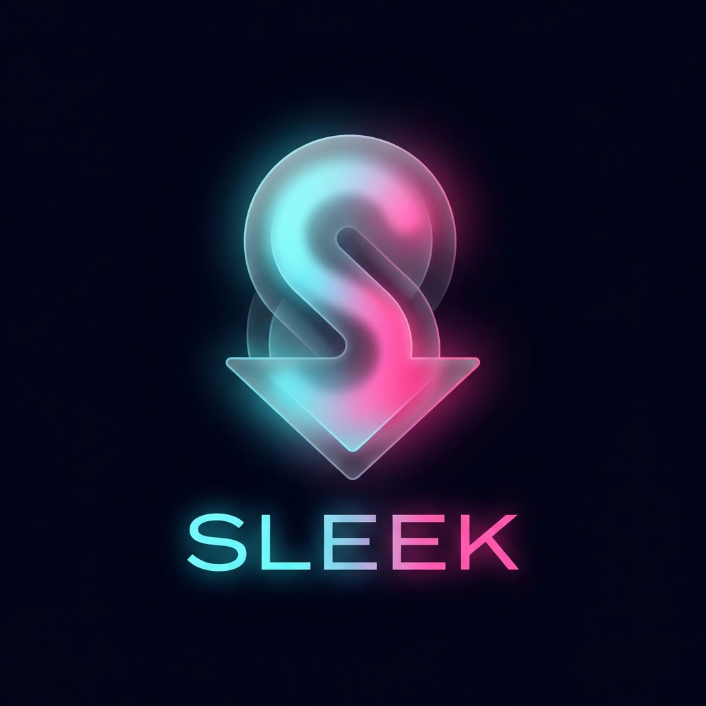

# Sleek Downloader

<p align="center">
  
</p>

<p align="center">
  <strong>Pure. Potent. Permanent.</strong><br>
  The last media archiver designed for the uncompromising perfectionist.
</p>

<p align="center">
  <a href="LICENSE"></a>
  
  
</p>

---
[English](README.md) | [한국어](README_ko.md)
---

## Desktop and agent CLI

The v2 bundled release candidate adds a native Electron window and a standalone Rust CLI. No browser or Flask server is opened. Both save descriptions, metadata and available comments by default. Windows and Linux x64 packages include the media tools. See the [desktop and CLI guide](docs/desktop-cli.md) for Windows setup, commands and the JSON protocol.

## 📖 Introduction

**Sleek** is a modern, minimalist YouTube downloader and media archiver. Built with **Flask** and powered by the robust **yt-dlp** engine, it wraps powerful functionality in a stunning, high-performance Glassmorphism UI.

Sleek is designed for those who value **aesthetics**, **privacy**, and **control**.

### ✨ Key Features

- **💎 Glassmorphism Design**: A beautiful, translucent user interface that blends with your system theme.
- **🌗 Adaptive Theming**: Automatically syncs with your system's Light/Dark mode, with a manual toggle.
- **🚀 8K Ready**: Supports extracting the highest possible quality video (up to 8K HDR) and lossless audio.
- **🔒 Privacy First**: All processing happens locally. No external servers, no tracking, complete data sovereignty.
- **📂 Smart Automation**: Remembers your preferred download paths and optimizes file formats automatically.
- **⚡ Async Processing**: Non-blocking download streams for a responsive experience.

## 🛠️ Technology Stack

- **Backend**: Python 3.12+, Flask
- **Core Engine**: yt-dlp
- **Frontend**: HTML5, Vanilla JS, CSS3 (Variables, Flexbox/Grid, Backdrop Filter)
- **License**: Apache 2.0

## 🚀 Installation & Setup

### 1. Portable packages
1. Open [Releases](https://github.com/hslcrb/pyflask_sleek-ytdownloader/releases) and select a package that explicitly lists your platform.
2. For the Windows x64 preview, run `Setup.exe` or extract the entire portable ZIP and double-click `SleekDownloader.exe`. If the browser does not open, visit `http://127.0.0.1:5000`.
3. For the older Linux archive, run the included `SleekDownloader` executable.

[Performance log](docs/2026-11-22-performance-windows.ko.md) · [Reproducible Windows EXE build (Korean)](docs/2026-11-22-windows-exe.ko.md)

### 2. Run via Docker
Sleek is available as a Docker image on GitHub Packages:
```bash
docker pull ghcr.io/hslcrb/pyflask_sleek-ytdownloader:latest
docker run -p 5000:5000 ghcr.io/hslcrb/pyflask_sleek-ytdownloader:latest
```
Navigate to `http://localhost:5000`.

### 3. Run from Source (For Developers)

#### Prerequisites
- Python 3.8 or higher
- **FFmpeg**: Required for merging video and audio streams.
- **python3-tk**: Required for the folder selection dialog on Linux (`sudo apt-get install python3-tk`).

#### Steps
1. **Clone the repository**
   ```bash
   git clone https://github.com/hslcrb/pyflask_sleek-ytdownloader.git
   cd pyflask_sleek-ytdownloader
   ```

2. **Run the start script** (Linux/macOS)
   ```bash
   ./start_server.sh
   ```

3. **Manual Setup**
   ```bash
   python -m venv venv
   source venv/bin/activate  # Windows: venv\Scripts\activate
   pip install -r requirements.txt
   python app.py
   ```

4. **Access the App**
   Open your browser and navigate to `http://localhost:5000`.

## 🤝 Contributing

Contributions are welcome! Please read our [CONTRIBUTING.md](CONTRIBUTING.md) for details on our code of conduct and the process for submitting pull requests.

## 📄 License

This project is licensed under the Apache License 2.0 - see the [LICENSE](LICENSE) file for details.

---
<p align="center">
  © 2026 Rhee Creative. Crafted with passion.
</p>
