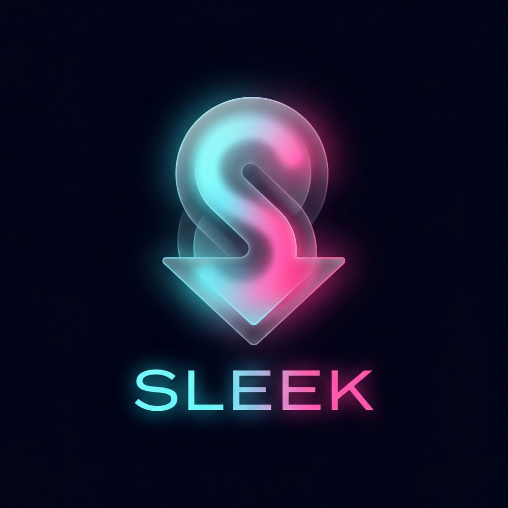

# Sleek Downloader (슬릭 다운로더)

<p align="center">
  
</p>

<p align="center">
  <strong>Pure. Potent. Permanent.</strong><br>
  타협하지 않는 완벽주의자를 위해 설계된 마지막 미디어 아카이버.
</p>

<p align="center">
  <a href="LICENSE_ko.md"></a>
  
  
</p>

---
[English](README.md) | [한국어](README_ko.md)
---

## Electron 데스크톱과 에이전트 CLI

v2 릴리즈 후보는 브라우저나 Flask 서버를 열지 않습니다. Electron 앱과 영어 명령의 Rust CLI가 같은 엔진을 사용하며, 설명·메타데이터·가져올 수 있는 댓글을 기본 저장합니다. 필요한 미디어 도구는 Windows와 Linux x64 패키지에 동봉됩니다. 설치와 영어 CLI, JSON 출력은 [사용 안내](docs/desktop-cli.md)를 참고하세요.

## 📖 소개

**Sleek(슬릭)**은 현대적이고 미니멀한 유튜브 다운로더이자 미디어 아카이버입니다. **Flask**를 기반으로 강력한 **yt-dlp** 엔진을 활용하며, 이 모든 기능을 아름다운 고성능 글래스모피즘(Glassmorphism) UI로 감쌌습니다.

Sleek은 **심미성**, **프라이버시**, 그리고 **통제권**을 중요시하는 분들을 위해 디자인되었습니다.

### ✨ 주요 기능

- **💎 글래스모피즘 디자인**: 시스템 테마와 자연스럽게 어우러지는 아름다운 반투명 사용자 인터페이스.
- **🌗 적응형 테마**: 시스템의 라이트/다크 모드와 자동으로 동기화되며, 수동 전환도 가능합니다.
- **🚀 8K 지원**: 최대 8K HDR 비디오와 무손실 오디오 추출을 지원합니다.
- **🔒 프라이버시 우선**: 모든 처리는 로컬에서 이루어집니다. 외부 서버 통신이나 추적이 없으며, 데이터 주권은 오직 당신에게 있습니다.
- **📂 스마트 자동화**: 선호하는 다운로드 경로를 기억하고 최적의 파일 포맷을 자동으로 감지합니다.
- **⚡ 비동기 처리**: 반응성 높은 경험을 위해 다운로드 스트림을 비동기로 처리합니다.

## 🛠️ 기술 스택

- **백엔드**: Python 3.12+, Flask
- **코어 엔진**: yt-dlp
- **프론트엔드**: HTML5, Vanilla JS, CSS3 (Variables, Flexbox/Grid, Backdrop Filter)
- **라이선스**: Apache 2.0

## 🚀 설치 및 시작하기

### 1. 포터블 패키지로 실행
1. [Releases](https://github.com/hslcrb/pyflask_sleek-ytdownloader/releases)에서 운영체제가 명시된 파일을 선택하세요.
2. Windows x64 프리뷰는 `Setup.exe`로 설치하거나 포터블 ZIP을 전부 풀어 `SleekDownloader.exe`를 실행합니다. 브라우저가 열리지 않으면 `http://127.0.0.1:5000`으로 접속하세요.
3. 이전 Linux ZIP은 포함된 `SleekDownloader` 실행 파일을 사용합니다.

[성능 개선 개발기](docs/2026-11-22-performance-windows.ko.md) · [Windows EXE 빌드와 사용법](docs/2026-11-22-windows-exe.ko.md)

### 2. Docker로 실행
Sleek은 GitHub Packages에서 Docker 이미지로 제공됩니다:
```bash
docker pull ghcr.io/hslcrb/pyflask_sleek-ytdownloader:latest
docker run -p 5000:5000 ghcr.io/hslcrb/pyflask_sleek-ytdownloader:latest
```
`http://localhost:5000`으로 접속하세요.

### 3. 소스 코드에서 실행 (개발자용)

#### 필수 조건
- Python 3.8 이상
- **FFmpeg**: 비디오와 오디오 스트림 병합에 필수적입니다.
- **python3-tk**: 리눅스 환경에서 폴더 선택 창을 사용하기 위해 필요합니다 (`sudo apt-get install python3-tk`).

#### 실행 단계
1. **저장소 클론하기**
   ```bash
   git clone https://github.com/hslcrb/pyflask_sleek-ytdownloader.git
   cd pyflask_sleek-ytdownloader
   ```

2. **시작 스크립트 실행** (Linux/macOS)
   ```bash
   ./start_server.sh
   ```

3. **수동 설정**
   ```bash
   python -m venv venv
   source venv/bin/activate  # Windows: venv\Scripts\activate
   pip install -r requirements.txt
   python app.py
   ```

4. **접속**
   브라우저에서 `http://localhost:5000`으로 접속합니다.

## 🤝 기여하기

기여는 언제나 환영합니다! 풀 리퀘스트(PR) 제출 절차와 행동 강령에 대한 자세한 내용은 [CONTRIBUTING_ko.md](CONTRIBUTING_ko.md)를 참고해주세요.

## 📄 라이선스

이 프로젝트는 Apache License 2.0 하에 배포됩니다. 자세한 내용은 [LICENSE_ko.md](LICENSE_ko.md) 파일을 참조하세요.

---
<p align="center">
  © 2026 Rhee Creative. 열정으로 제작되었습니다.
</p>
