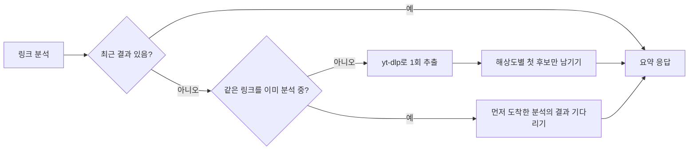

# Sleek 개발기: 중복 추출을 줄이고 Windows 패키지를 분리하다

2026-11-22 · 기준 소스 [c9c93dd](https://github.com/hslcrb/pyflask_sleek-ytdownloader/commit/c9c93dd5131d8f6f9f5cca0425084af303d4b65b) · 배포 후보 `v1.1.0-rc.1`

## 1. 요청이 실제로 시간을 쓰고 있던 곳

홈은 영상 링크를 Flask의 `POST /api/info`에 보내고, 서버는 매번 새 yt-dlp 인스턴스로 제목·썸네일·길이·화질을 조회했다. 같은 링크를 다시 분석해도 추출부터 전부 반복했다. 다운로드 큐를 빨리 돌리는 것과 메타데이터 반복을 줄이는 것은 다른 문제다. 이번에는 후자를 먼저 해결했다. 실제 비디오의 네트워크 전송, FFmpeg 변환 시간 또는 유튜브 CDN 처리량을 개선했다고 주장하지 않는다.

원래 알고리즘은 모든 화질 후보를 해상도로 정렬하고 같은 높이를 제거했다. 대부분의 메타데이터에서는 코덱이나 전송 방식이 달라도 높이는 반복된다. 결과의 권장 순서를 바꾸지 않으려 각 높이에서 추출기가 준 첫 비디오 후보를 먼저 보존한 뒤 남은 높이만 내림차순 정렬한다. 같은 높이가 여러 번 나와도 첫 항목 우선이라는 기존 동작과, 오디오 전용 후보 제외, 파일 크기의 근사값 대체를 유지했다. 길이가 없는 응답도 `00:00`을 반환한다.



## 2. 캐시의 범위와 실패 처리

- 성공한 **요약 결과만** 프로세스 메모리에 30초 보관한다. 최근 사용 기준으로 최대 64개다. 원본 yt-dlp 결과나 다운로드 URL에 해당하는 별도 스트림 객체, 쿠키·비밀번호·미디어 파일을 저장하지 않는다.
- 동일 URL을 처리 중이면 Future를 공유한다. HTTP 작업 원본이 끝날 때까지 같은 키의 다른 요청도 기다리지만, 다른 URL의 추출은 잠금 밖에서 함께 진행할 수 있다. 애플리케이션의 각 프로세스는 자체 캐시를 갖는다.
- 오류는 저장하지 않는다. 진행 중인 후속 요청에는 같은 실패를 전달하지만, 이후 요청이 그 URL을 다시 추출할 수 있다. 입력 타입이 잘못되거나 비어 있으면 추출 전에 HTTP 400을 반환한다.
- URL 앞뒤 공백만 정리한다. 쿼리 문자열을 임의로 정규화하거나 서로 다른 링크를 하나로 합치지 않는다. 캐시 응답을 다운로드 요청에 쓰지 않으므로 실제 다운로드 시에는 원래처럼 다시 소스를 확인한다.
- 새 결과는 최신 성공 시점으로부터 30초간 유지된다. 반복 요청이 TTL을 연장하지 않는다. 라이브 방송처럼 빨리 바뀌는 콘텐츠에는 그만큼 미리보기 정보가 잠깐 늦게 반영될 수 있다.

## 3. 소개 화면의 전송량 절감

기존 `favicon.png`는 확장자와 달리 1024×1024 JPEG였고 436,814바이트였다. 별도 64×64 PNG를 만들어 실제 파비콘 용도에 맞췄다. README가 쓰는 원본 로고는 그대로다. 소개 화면은 자체 애니메이션 스크립트만 필요하지만 다운로드 화면용 10,191바이트 스크립트도 불러왔다. 소개에는 테마 버튼 등 다운로드 화면 DOM이 없어 그 스크립트가 오류로 중단될 수 있었다. 소개에서만 이 참조를 제거하고 홈은 그대로 뒀다.

| 항목 | 이전 | 이후 | 측정 기준 |
|---|---:|---:|---|
| 파비콘 원본 | 436,814 B | 4,788 B | 저장소 파일 크기, 98.9% 감소 |
| 소개의 다운로드 스크립트 | 10,191 B | 0 B | 해당 리소스 원본 크기. 압축 전 |
| 위 두 초기 리소스 합계 | 447,005 B | 4,788 B | 브라우저 캐시가 없을 때 필요한 원본 크기 비교 |

## 4. 재현 가능한 측정

Python 3.12의 Flask 테스트 클라이언트에서 원래 코드와 변경본을 번갈아 9회 측정하고 중앙값을 냈다. URL 한 건에 같은 해상도가 섞인 180개 형식을 돌려주는 가짜 추출기를 붙였다. 같은 링크 20개를 넣는 경우 네트워크 비용을 모사해 추출당 25ms를 주었고, 링크가 모두 다른 경우 인위적인 지연 없이 로컬 처리 비용을 비교했다. 응답 JSON이 전후 같은지도 매 회차 비교했다.

| 시나리오 | 이전 추출 | 이후 추출 | 이전 중앙값 | 이후 중앙값 |
|---|---:|---:|---:|---:|
| 같은 링크 20개, 25ms 모의 대기 | 20회 | 1회 | 514.99ms | 29.03ms |
| 다른 링크 20개, 모의 대기 없음 | 20회 | 20회 | 5.26ms | 5.36ms |

같은 링크 조건에서 이 작은 실험의 총시간은 약 17.7배 빨라졌다. 다른 링크 조건은 오히려 0.10ms 길었고, 이 정도 차이는 실행 간 변동과 비교하지 않았으므로 개선·회귀로 단정할 수 없다. 또한 위 수치는 인터넷에서 받는 실제 미디어 속도, 브라우저 LCP, 서버 동시 접속 부하 측정치가 아니다. 실제 환경에서 새 링크가 대부분이라면 같은 링크 조건과 같은 이득을 기대해서는 안 된다.

```sh
python -m pip install -r requirements.txt
python -m unittest discover -s tests -v
python scripts/benchmark_metadata.py
```

## 5. Windows x64 포터블을 만드는 방법

기존 릴리즈는 Windows와 macOS를 함께 설명했지만 GitHub 자산에는 Linux ZIP만 있었다. 비활성화한 GitHub Actions를 켜는 대신, [Python 공식 Windows 런타임](https://www.python.org/downloads/windows/)과 해시를 고정한 Windows x64 wheel을 묶어 재현 가능한 포터블 ZIP을 구성했다. PyInstaller가 Linux에서 자동으로 Windows EXE를 만드는 방식이 아니다. ZIP에는 공식 Windows `python.exe`와 런타임 DLL, 애플리케이션, 의존성, 압축 해제 후 실행하는 `SleekDownloader.cmd`가 들어 있다. 단일 앱 EXE나 설치 프로그램은 아니다.

런처는 포트가 열렸을 때만 기본 브라우저를 열고 127.0.0.1에만 바인딩한다. 임베딩 Python은 Tcl/Tk가 없어서 Windows에서만 PowerShell 폴더 선택 창으로 대체한다. 관리 정책으로 이 창을 열 수 없어도 경로를 직접 입력할 수 있다. Windows와 PowerShell에서 직접 대화상자를 띄워 검증하지 않았으므로 해당 부분은 정식판 승격 전에 확인해야 한다. Python 자체는 따로 설치하지 않아도 되지만, MP3 변환과 분리된 영상·음성 병합에 필요한 FFmpeg는 포함하지 않는다. 소스별 요구 사항은 [yt-dlp 공식 문서](https://github.com/yt-dlp/yt-dlp#dependencies)를 참고할 수 있다.

```sh
mkdir -p /tmp/sleek-win/wheels
curl -fL https://www.python.org/ftp/python/3.13.17/python-3.13.17-embed-amd64.zip \
  -o /tmp/sleek-win/python-3.13.17-embed-amd64.zip
python -m pip download --require-hashes --no-deps --only-binary=:all: \
  --platform win_amd64 --python-version 3.13 --implementation cp --abi cp313 \
  -r packaging/windows/requirements-win-amd64.lock -d /tmp/sleek-win/wheels
python scripts/build_windows_portable.py /tmp/sleek-win dist/SleekDownloader-Windows-x64.zip
```

빌드 스크립트는 CDN이나 파이썬 레지스트리에 직접 연결하지 않는다. 런타임 해시를 검사하고, 로컬 wheel만 조회하며, 해시가 다르면 빌드를 중단한다. ZIP의 항목 순서와 타임스탬프를 고정한다. CPython과 제3자 의존성의 라이선스 파일은 ZIP에 포함한다.

## 6. 시행착오와 남은 검증

- 메타데이터 캐시만 먼저 추가하면 실패 결과도 재사용하기 쉬웠다. 동시에 기다린 요청에 실패는 전달하되 실패 항목은 보관하지 않는 테스트를 추가했다.
- 소개 화면에서 같은 JS를 계속 쓰는 대신, 실제 필요한 초기화만 남겼다. Flask 경로 테스트로 홈의 스크립트가 실수로 제거되지 않았는지 같이 검사했다.
- 결과 비교는 전체 문자열 또는 단일 타이밍을 믿지 않고 요청 수, JSON 동등성, 9회 중앙값을 모두 기록했다. 콜드 링크에서 캐시 비용이 사라진다고 주장하지 않는다.
- ZIP에서 PE x64 헤더·런처·정적 자산·라이선스를 확인하고, 압축을 해제한 코드와 동봉 라이브러리로 로컬 HTTP 경로를 점검했다. 이 호출은 Linux에서 실행했으므로 Windows 네이티브 실행 결과는 아니다.
- 정식 승격 전 Windows 10/11 x64 실기기에서 더블클릭, 폴더 선택(한글 경로 및 취소), 로컬 다운로드 저장, FFmpeg 변환을 각각 확인한다. 아래 명령으로 우선 패키지 로딩과 HTTP 경로를 검사할 수 있다: `SleekDownloader.cmd --smoke-test`.
