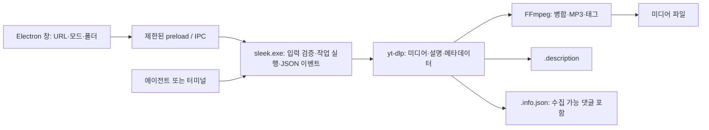

# Sleek v2 개발기: Electron 앱과 Rust 엔진

## 왜 실행 구조를 바꿨나

v1의 Windows EXE는 Python과 Flask를 시작하고 기본 브라우저를 여는 실행기였다. 설치형 EXE를 만들었다고 해서 브라우저 기반 인터페이스가 사라지지는 않았다. v2는 이를 분리한다. Electron은 파일로 묶은 UI를 자체 창으로 열고 다운로드 요청만 Rust 프로세스에 전달한다. CLI는 같은 실행 파일을 터미널에서 직접 사용한다. 기존 Flask 소스와 이전 릴리즈는 지우지 않았지만 v2의 앱과 CLI에서는 실행하지 않는다.

## 구현에서 지킨 경계

- UI는 외부 사이트를 웹뷰로 열지 않는다. 팝업과 새 페이지 탐색을 막고, 렌더러 Node 권한을 끈 상태에서 파일 선택·다운로드·취소 등 필요한 IPC 기능만 노출한다. 명령 인자를 배열로 넘기며 쉘을 사용하지 않는다.
- URL은 HTTP(S)만 받으며 사용자명이나 비밀번호를 넣은 URL은 거부한다. 다운로드 엔진은 사용자 홈의 yt-dlp 설정을 자동으로 적용하지 않는다. 다중 항목 폭주를 피하도록 한 작업은 한 항목으로 제한했다.
- 아카이브에는 원본 설명과 정보 JSON을 별도로 남기고 미디어 자체에는 가능한 제목 등 태그를 삽입한다. 댓글 수집은 기본 켜짐이지만 작품 설정이나 추출기 제한으로 무엇을 가져올 수 있는지는 사이트마다 다르다. 영상과 MP3가 동일한 메타데이터 기본 옵션을 사용한다.
- 진행 이벤트는 줄 단위 JSON 형식을 고정하고 도구 진단은 stderr로 분리한다. 예상 크기를 모를 때 가짜 진행률을 만들지 않는다. CLI는 완료된 미디어의 실제 경로와 존재하는 보조 파일 경로를 알린다.
- Electron 창은 처음 열릴 때 모니터의 작업 영역보다 크게 만들지 않고, 작은 높이에서는 스크롤할 수 있다. Windows에선 내부 프로세스 콘솔을 숨긴다. 외부 FFmpeg·FFprobe를 사용할 수 있어야 하며 YouTube에서는 Deno 설치를 권장한다.

## 빌드에서 막혔던 곳과 선택

초기 Zig+GNU 링커 연결에서는 Windows Rust 표준 라이브러리가 요구한 MinGW import library 일부를 찾지 못했다. 코드 컴파일과 Windows 링킹 성공은 별개이므로, Linux 환경에 Debian의 MinGW를 시스템 설치하지 않고 작업 폴더에서 풀어 다시 빌드했다. 그 결과 Rust 실행 파일을 x86-64 PE로 확인했다. 설치 EXE는 별도 NSIS 빌드다. Electron과 yt-dlp는 공식 Windows 자산을 내려받아 SHA-256을 확인했다. Electron의 라이선스와 Chromium 고지는 동봉한다. FFmpeg·FFprobe·Deno는 별도 설치로 남겼기 때문에 이 릴리즈 후보를 의존성까지 포함한 완전 오프라인 설치본이라고 부르지 않는다.

## 확인한 것과 남은 것

- Rust 테스트는 인자·공통 메타데이터 옵션·영어 도움말·오류 JSON을 확인하고, Node 테스트는 렌더러 입력 경계와 작은 창 크기를 확인한다.
- 생성한 1초 영상만 루프백에서 제공해 실제 Rust → yt-dlp → FFmpeg 흐름을 검증했다. 영상과 MP3에서 미디어, 정보 JSON, 원본 설명 파일을 확인했고 FFprobe로 미디어에 제목 태그가 들어가는 것을 확인했다.
- 댓글은 추출기 옵션 전달까지 자동 테스트에 있고, 실제 YouTube 댓글을 가져오는 종단 검증은 하지 않았다. 샘플 서버는 댓글이 없는 생성 영상이다.
- Windows 실기기에서 설치, 실행, 폴더 대화상자, 다중 모니터 및 취소 동작은 아직 검증하지 않았다. Windows 빌드와 PE/압축 확인은 Windows에서 직접 사용했다는 뜻이 아니다.
